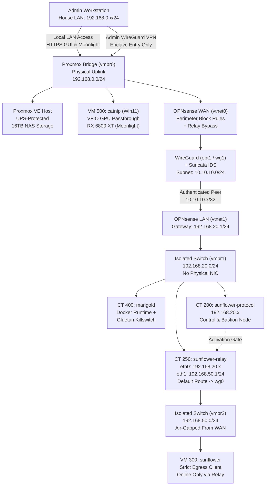

# Proxmox VE Virtualization & Multi-Tier Zero-Trust Network Architecture

> **OpSec Notice:** All host IP addresses, VPN endpoint IPs, port numbers, cryptographic keys, and personal identifiers in this documentation have been sanitized or replaced with generic RFC1918 ranges for operational security.

## Overview
This repository documents the network segmentation, hardware virtualization (VFIO/PCIe passthrough), packet inspection, power/storage resilience, and multi-hop VPN egress controls for my self-hosted **Proxmox VE** hypervisor. The architecture separates the local household LAN bridge (`vmbr0`) from two isolated virtual network enclaves (`vmbr1` and `vmbr2`) governed by a virtualized **OPNsense** firewall, **Suricata IDS**, a dedicated **WireGuard** interface (`opt1`), and container egress gateways.

---

## Architecture & Traffic Flow

---

## Core Security, Infrastructure & Availability Controls

### 1. Three-Tier Network Segmentation (`vmbr0` / `vmbr1` / `vmbr2`)
* **Household LAN / Upstream Bridge (`vmbr0` — `192.168.0.0/24`):** Bridges the Proxmox VE management interface, the GPU-passthrough workstation (`VM 500`), and the OPNsense WAN interface (`vtnet0`) to the local household LAN (with zero external port forwarding).
* **Primary Isolated Enclave (`vmbr1` — `192.168.20.0/24`):** A virtual switch with **no physical ports attached**, routing all traffic through OPNsense (`192.168.20.1`) and governed by top-down perimeter firewall rules and WireGuard peer authentication (`10.10.10.0/24`).
* **Secondary Restricted Enclave (`vmbr2` — `192.168.50.0/24`):** A completely air-gapped internal bridge with **zero direct route** to `vmbr0` or OPNsense. Its sole gateway (`192.168.50.1`) is `CT 250` (`sunflower-relay`).

### 2. Perimeter Firewall Ordering, Assigned WireGuard Interface & Suricata IDS (`VM 199`)
* **Dedicated WireGuard Interface (`opt1` / `wg1`):** Assigned the WireGuard tunnel as a first-class OPNsense interface (`WAN_VPN`) rather than relying solely on group rules, enabling granular per-interface firewall filtering and clean routing table visibility.
* **Top-Down Perimeter Rule Ordering:** Because `Block Private Networks` is disabled for double-NAT lab routing, OPNsense enforces explicit top-down WAN perimeter block rules against RFC1918 ranges (`10.0.0.0/8`, `172.16.0.0/12`, `192.168.0.0/16`), preceded strictly by an explicit host-level bypass rule for `CT 250` (`sunflower-relay`) and authenticated WireGuard UDP ingress.
* **Hybrid Outbound NAT with Static Port Translation:** Configured a dedicated Source NAT rule for `CT 250` (`UDP`, Static Port enabled) to preserve source ports across double-NAT traversal and prevent intermittent WireGuard handshake drops.
* **Intrusion Detection & Packet Inspection (`Suricata`):** Configured Suricata in IDS mode on the OPNsense LAN interface (`vtnet1`) with Emerging Threats (ET Open) rulesets to inspect enclave traffic, detect anomalous DNS/scan activity, and generate structured alert telemetry.

### 3. Autonomous Gated Egress & Endpoint Pin-Holing (`CT 200` + `CT 250` → `VM 300`)
* **Fail-Closed Connectivity (Independent of Admin VPN):** `VM 300` (`sunflower`) operates independently of the workstation's WireGuard tunnel, but cannot reach external networks unless both `CT 200` (`sunflower-protocol`) and `CT 250` (`sunflower-relay`) are running.
* **Host-Routed VPN Killswitch:** `CT 250` enforces a static `/32` host route (`<VPN_ENDPOINT_IP> via 192.168.20.1`) for the encrypted Mullvad WireGuard handshake while setting the virtual tunnel interface (`wg0`) as the system `default` gateway—preventing clearnet traffic leaks if the tunnel drops.

### 4. Containerized Egress Isolation (`CT 400`)
* **Container Namespace Sharing (`network_mode: service:gluetun`):** Selected Docker workloads share the network namespace of a **Gluetun** WireGuard gateway container with an active firewall killswitch.
* **Explicit Enclave IP Binding:** Published Docker ports are bound strictly to the container's static `192.168.20.x` interface rather than wildcard `0.0.0.0`.

### 5. Hardware Virtualization, Power Continuity & Storage Availability
* **VFIO PCIe GPU Passthrough (`VM 500`):** Configured IOMMU groups and VFIO kernel bindings to pass a dedicated AMD Radeon RX 6800 XT directly to a Windows guest (`catnip`) on `vmbr0`, enabling low-latency local workstation access via Sunshine/Moonlight without dual-booting.
* **Power Continuity (UPS) & NAS Storage:** Hypervisor and 16TB NAS storage pool are backed by an Uninterruptible Power Supply (UPS) to prevent unclean filesystem shutdowns and storage corruption during power events.

---

## Automation & Baseline Auditing

* **`scripts/audit-enclave.sh`:** Read-only Bash compliance script executed on the Proxmox VE host to verify that `vmbr1`/`vmbr2` remain detached from physical NICs, confirm `CT 250`'s default route is bound to the WireGuard killswitch interface, and audit `CT 400` Docker containers for accidental `0.0.0.0` wildcard bindings.

---

## Key Engineering Decisions & Trade-Offs

| Configuration Choice | Technical Rationale |
| :--- | :--- |
| **Assigned `opt1` (`wg1`) WireGuard Interface** | Assigning the tunnel to an explicit OPNsense interface provides deterministic state tracking, clean routing entries, and strict separation between VPN control-plane and data-plane rules. |
| **Hybrid Outbound NAT (Static Port for `CT 250`)** | Prevents OPNsense from randomizing UDP source ports on outbound WireGuard packets from `sunflower-relay`, eliminating double-NAT tunnel stalls. |
| **Decoupled Admin VPN vs. Workload VPN (`CT 250`)** | Separating the workstation's WireGuard management tunnel (`10.10.10.0/24`) from `VM 300`'s upstream Mullvad tunnel (`wg0`) prevents routing conflicts and allows `VM 300` to operate fail-closed whenever `CT 200` + `CT 250` are active. |
| **Static `/32` Endpoint Route + `default dev wg0`** | Pin-holing only the encrypted VPN endpoint IP through `192.168.20.1` while setting `wg0` as the default route guarantees fail-closed egress isolation for `192.168.50.0/24` without complex policy routing tables. |
| **Proxmox GUI & Moonlight on `vmbr0` (Local LAN Only)** | Prevents hypervisor self-lockout if the virtualized OPNsense firewall (`VM 199`) is offline for maintenance and avoids VPN encryption overhead on local high-framerate Moonlight streams, while keeping management ports unexposed externally. |
| **Suricata in IDS Mode First** | Running Suricata in alert-only IDS mode prior to enabling IPS blocking allows baseline tuning of Emerging Threats rulesets without breaking encrypted WireGuard handshakes. |
| **Explicit IP Binding vs. `0.0.0.0`** | Prevents accidental service exposure across secondary virtual bridges. |
| **LXC + KVM Hybrid Topology** | Uses KVM (`VM 199`, `VM 300`, `VM 500`) where kernel isolation or PCIe passthrough is required, and lightweight LXC containers (`CT 200`, `CT 250`, `CT 400`) for routing and service hosting. |

---

## To-Do List
* [ ] **Audit & Migrate `CT 400` SSH Access:** Test direct SSH routing over the WireGuard tunnel (`10.10.10.0/24` → `192.168.20.40`) with fallback console access (`pct enter 400`), then retire the legacy WAN Destination NAT SSH rule (`TCP 2222`) while keeping household LAN NAT scoped strictly to media playback ports.
* [ ] **Clean Up Duplicate Firewall Rules:** Consolidate redundant Floating vs. WAN WireGuard inbound rules on `VM 199` after verifying packet counters.
* [ ] **Harden Proxmox Management Plane (`vmbr0`):** Enable **2FA (TOTP)** on the Proxmox VE root/admin account and configure host-level firewall rules restricting port `8006` and SSH exclusively to the admin workstation IP.
* [ ] **Expand NAS to RAID-1 Mirror:** Add a second **16TB enterprise drive in RAID-1** to eliminate single-disk failure risk on the storage pool.
* [ ] **Configure `NUT` (Network UPS Tools):** Automate graceful VM/LXC shutdown sequences on `mania-gran` when UPS battery capacity drops below threshold.
* [ ] **Deploy Windows Server Domain Controller:** Build an isolated Active Directory domain on `vmbr1` to practice Group Policy hardening, OU delegation, and least-privilege access auditing.
